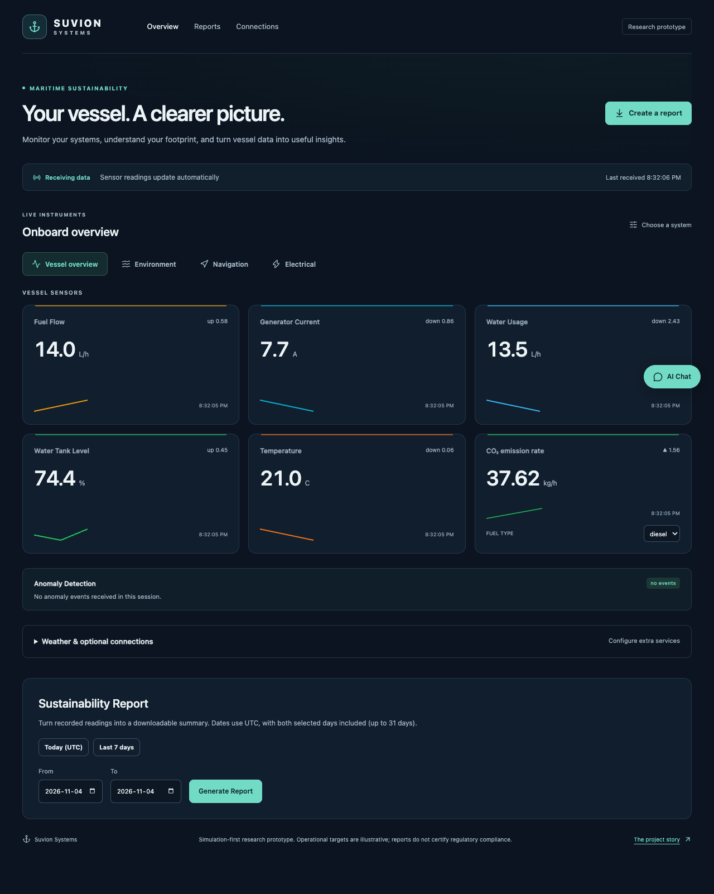
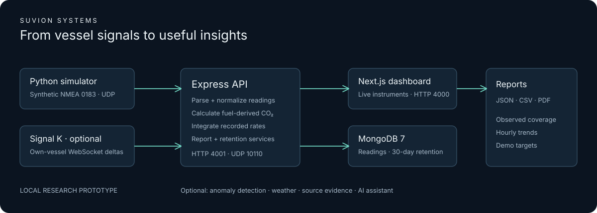

# Suvion Systems

**A clearer picture of your vessel's environmental footprint.**

A simulation-first maritime monitoring dashboard for small-vessel operators.
Watch fuel, water, generator, and navigation data arrive in real time, estimate
fuel-derived CO₂, and export a sustainability summary as CSV or PDF.

Built as a BCIT Applied Computer Science capstone.
Read the [BCIT project story](https://www.bcit.ca/news/stories/computing-capstone-project-maritime-sustainability/)
for background. The guides below describe the software available in this repository.



[Quick start](#quick-start) · [User guide](docs/user-guide.md) ·
[Architecture](docs/architecture.md) · [Contributing](CONTRIBUTING.md) ·
[Security](SECURITY.md) · [Release review](docs/release-readiness.md)

## What you can do

- Monitor live fuel flow, generator current, water usage, temperature, and CO₂.
- Switch between vessel, environment, navigation, and electrical instruments.
- See disconnected, waiting, and stale-feed states without mistaking missing readings for zero use.
- Generate date-range reports with observation coverage, hourly trends, and downloadable CSV/PDF files.
- Explore cruising, anchoring, and generator-cycling scenarios without boat hardware.
- Optionally connect Signal K, Python anomaly detection, weather, or an AI assistant.
  The core demo needs no external API keys.

This is a **local research prototype**. Thresholds are illustrative operational
targets, and fuel density is an engineering assumption. Reports do not certify
regulatory compliance. Authentication, multi-vessel isolation, and real-world
sensor validation are future work; see [deployment boundaries](SECURITY.md).

## Quick start

Install [Docker Desktop](https://docs.docker.com/desktop/) with Compose v2 and start
its engine. From a clone of this repository:

```sh
# Only copy if you do not already have a .env file.
cp -n .env.example .env
docker compose up --build -d
```

Open [the dashboard](http://localhost:4000). The stack includes MongoDB, the API,
the dashboard, and a simulator. Allow time for the first image build. Readings
appear automatically once the API is healthy.

```sh
# Check startup and see the feed.
docker compose ps
docker compose logs --tail=50 api simulator

# Change the synthetic vessel scenario.
SIM_SCENARIO=anchoring docker compose up -d simulator

# Stop the stack; recorded data stays in its Docker volume.
docker compose down
```

Ports bind to loopback by default. No external Docker network creation is needed.
Do not run a second host simulator while the Docker simulator is active.

## Native development

Requirements: Node **22+** (`nvm use` reads `.nvmrc`), npm **10+**, Python **3.10+**,
and a local MongoDB **7** instance or Docker. The optional Signal K submodule is
not required to install, test, or build Suvion.

```sh
npm ci
# Only if .env does not exist:
cp -n .env.example .env

docker compose up -d mongo
npm run build -w @repo/logger
npm run build -w @repo/emissions
```

Run these in separate terminals from the repository root:

```sh
npm run dev -w api
npm run dev -w web
python3 simulation/nmea_generator.py --scenario cruising
```

Open [localhost:4000](http://localhost:4000). The API reads the root `.env` as a
fallback; workspace-local settings and exported environment variables take
precedence. The simulator uses the Python standard library only.

For a production-mode local run, use `npm run build`, then start `api` and `web`
in separate terminals with `npm run start -w api` and `npm run start -w web`.
MongoDB and a data source must also be running.

## How it works



| Location              | Responsibility                                                              |
| --------------------- | --------------------------------------------------------------------------- |
| `apps/web`            | Next.js 15 / React 19 dashboard, Socket.IO client, report workflow          |
| `apps/api`            | Express REST API, UDP ingestion, Signal K bridge, persistence and retention |
| `packages/emissions`  | Pure TypeScript fuel factors, calculations, input-aware 60-second cache     |
| `analytics`           | Standard-library Python anomaly model; optional `pymongo` connector         |
| `simulation`          | Synthetic NMEA 0183 feed and vessel scenarios                               |
| `infra`               | MongoDB collection validators and indexes                                   |
| `apps/signalk-server` | Optional Apache-2.0 upstream submodule, excluded from core workspaces       |

The [architecture review](docs/architecture.md) explains data flow, trust boundaries,
tradeoffs, and the remaining work before a hosted or operational deployment.

## Calculations and reporting

```text
CO₂ (kg) = fuel volume (L) × density (kg/L) × fuel-to-CO₂ factor (kg/kg)
```

Fuel and water rates (`L/h`) and CO₂ rates (`kg/h`) are integrated over elapsed
sample intervals. A reading is held for at most five minutes by default; longer
gaps are excluded and coverage is included in the report. This prevents a stopped
simulator from generating a full day's apparent consumption.

IMO mass-basis conversion factors and representative densities are documented in
[the calculation references](docs/references.md). The per-litre factor is **not**
a vessel's IMO CII rating. Historical CO₂ totals preserve the fuel setting used at
ingestion. The report's `fuelType` parameter chooses a reference comparison; it
does not rewrite stored emissions.

```sh
curl 'http://localhost:4001/report?startDate=2026-11-03T00:00:00Z&endDate=2026-11-04T00:00:00Z&format=csv'
```

Use a period that actually contains your simulator data. API timestamps require
an explicit timezone; ranges are limited to 31 days. See the
[API guide](docs/api.md) and [user guide](docs/user-guide.md).

## Verification

```sh
npm run check
npm audit --omit=dev

# With the local stack and simulator running:
npm run smoke:runtime
npx playwright install chromium
npm run test:browser
```

Tests include pure emissions calculations, parser and unit-conversion regressions,
missing-data integration, HTTP boundaries, and a temporary MongoDB database. The
first integration run may download a MongoDB binary. Python tests need no third-party
packages. See [release verification](docs/release-readiness.md) for measured results
and remaining limitations.

## Optional integrations

All configuration is described in [.env.example](.env.example). Keep server keys
out of `NEXT_PUBLIC_*` variables. Weather is requested explicitly from the dashboard;
AI text/voice requires a key and an explicit enable flag. Enabling external services
can send vessel context or coordinates to their providers.

See [the integration guide](docs/integrations.md), [Signal K notes](docs/signalk-architecture.md),
and [the security policy](SECURITY.md) before enabling them.

## License and acknowledgments

Original Suvion code is available under the [MIT license](LICENSE).
[Signal K](https://signalk.org/) and other dependencies retain their own licenses;
see [third-party notices](THIRD_PARTY_NOTICES.md). BCIT, IMO, and EPA references do
not imply endorsement. The [documentation index](docs/README.md) covers setup,
usage, architecture, and maintenance of the current implementation.
