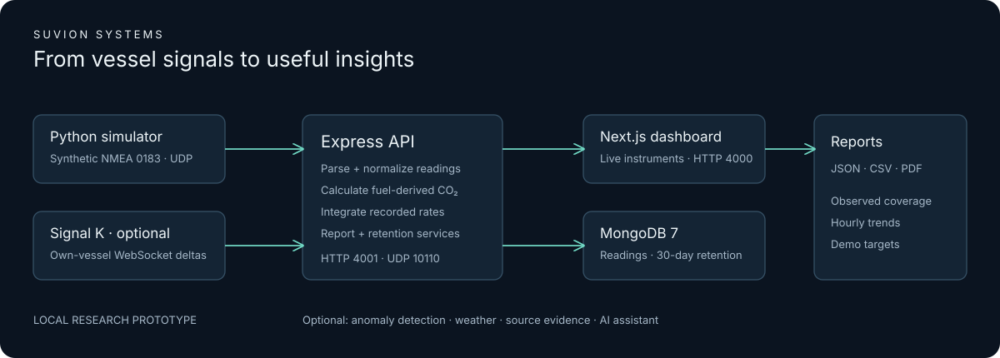
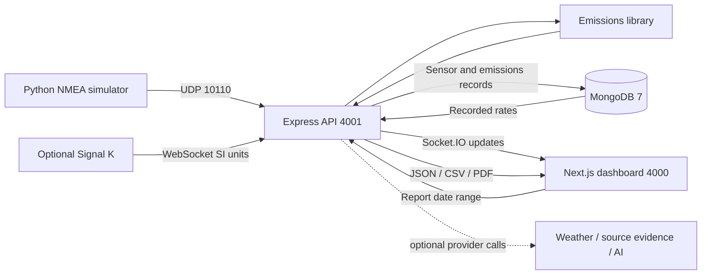

# Architecture review

Suvion is a single-vessel, simulation-first modular monolith with a separate web
client. It is suitable for a reproducible local demonstration release. Its current
trust model and storage design need further work before shared hosting or real-vessel use.

## Component boundaries

| Component         | Inputs and outputs                                             | Design assessment                                                                                                             |
| ----------------- | -------------------------------------------------------------- | ----------------------------------------------------------------------------------------------------------------------------- |
| NMEA adapter      | Checksummed simulator sentences → typed readings               | Small, independently tested boundary. This is a simulator-specific subset, not a complete NMEA implementation.                |
| Signal K adapter  | Own-vessel deltas → readings in display/report units           | Keeps marine protocols outside the UI. Fuel `m³/s` is converted to `L/h` using ×3,600,000.                                    |
| API composition   | Routers, parsers, readiness, CORS and limits                   | `src/app.ts` can be tested without starting adapters; `src/index.ts` owns runtime startup and shutdown.                       |
| Emissions library | Fuel type + litres → kg CO₂                                    | Pure and deterministic. The cache keys on fuel type **and input volume/rate**, with a 60-second TTL.                          |
| Persistence       | Four sensor streams, emissions, anomalies, lifecycle records   | Ordinary MongoDB collections with timestamp indexes and collection validators. These are not MongoDB time-series collections. |
| Reporting         | Stored rates → interval totals, coverage, comparisons, exports | Integration is shared by totals and hourly buckets. A sample expires after `REPORT_MAX_SAMPLE_AGE_SECONDS` (default 300).     |
| Dashboard         | Live readings + REST responses → instruments and reports       | Values expire after 15 seconds. Connection state is separate from feed freshness. Optional services sit behind a disclosure.  |
| Analytics         | Recorded windows → experimental anomaly events                 | Optional Python process. Disabled by default; not a safety alarm or validated anomaly classifier.                             |

## Runtime flow and ownership

1. The API connects to MongoDB, synchronizes validators/indexes, runs retention,
   and starts adapters. Native HTTP and UDP listeners default to loopback.
2. The simulator sends one sentence per datagram; the UDP receiver also supports
   newline-separated sentences. The bridge maps own-vessel Signal K paths.
3. Readings are broadcast immediately. Fuel readings also calculate CO₂ using the
   process-wide fuel setting. Only fuel, generator, water-use, and ambient-temperature
   sensor streams are persisted; navigation/tank/electrical data are live-only.
4. Sensor writes are batched every 500 ms with a bounded pending queue. Emissions
   writes are asynchronous. Displaying a reading does not guarantee it was durably saved.
5. Reports query indexed streams, integrate rates, and expose observation coverage.
   Fresh samples immediately before the range boundary can contribute until expiry.
   Empty coverage is explicitly marked `no_data`; gaps are never treated as zero use.
6. Retention deletes sensor, emissions, and anomaly data older than 30 days at
   startup and daily thereafter. SIGINT/SIGTERM stop adapters/timers, flush pending
   sensor writes, close sockets, and disconnect MongoDB.

## Calculation semantics

The emissions library calculates combustion CO₂ from volume, density, and a
mass-basis conversion factor. When its input is `L/h`, its output is `kg/h`.
Reports use a piecewise-constant hold between samples, capped by sample expiry.
A five-minute hold is an estimation assumption, not proof of observation throughout
the interval. Coverage measures modeled sample support, not sensor calibration quality.

Fuel type is shared server state and affects future readings. Report reference
fuel selection does not recalculate history; `fuelTypesObserved` lists recorded types.
The JSON fields `summaryStatus: compliant` and `nonCompliantPeriods` are retained
for API compatibility. They mean **within demo operational targets** and **threshold
exceedances**, respectively. The UI uses those clearer terms. They do not establish
regulatory compliance. Comparison vessel targets are illustrative, not an empirical
fleet dataset. See [references](references.md).

## Trust boundaries

The local operator, simulator, API, and database form a trusted single-user demo.
CORS and Socket.IO origins are allowlisted. HTTP bodies, prompt length, report
ranges, and report/validation/weather request rates are bounded. External services
are optional; AI requires explicit enablement. Official-source verification matches
exact HTTPS hostnames rather than substrings. MongoDB URIs are not printed in logs.
Docker build contexts exclude local secrets and the upstream source checkout.

These controls do not authenticate users or UDP senders. Any authorized browser
client can change the process-wide fuel type, and local programs can access the
API. An authenticated gateway alone must also protect Socket.IO upgrades. See
[SECURITY.md](../SECURITY.md) before changing loopback bindings.

## Verification

Tests cover calculations, changing-flow cache behavior, protocol units, missing
sample intervals, MongoDB validation, HTTP boundaries, and browser smoke paths.
See [runtime verification](integration-testing.md) for commands and
[release readiness](release-readiness.md) for the dated results. Tests against
synthetic fixtures do not establish hardware accuracy or certification.

## Remaining architecture work

| Priority                     | Work                                                                                              | Reason                                                                                      |
| ---------------------------- | ------------------------------------------------------------------------------------------------- | ------------------------------------------------------------------------------------------- |
| Before hosting               | Authentication, authorization, per-vessel identities, TLS, secret management                      | The prototype trusts a local operator.                                                      |
| Before operational use       | Calibrated hardware, source identity, duplicate-source handling, vessel-specific fuel density     | Simulated results do not establish real sensor accuracy. Use only one fuel feed at a time.  |
| Before durability guarantees | Durable ingestion queue, retry/deduplication, atomic sensor/emissions records                     | Current failed writes can be lost; process crashes can lose pending data.                   |
| Before scale                 | Server-side aggregation/downsampling and report pagination/jobs                                   | A 31-day high-frequency range can still require substantial memory.                         |
| Reliability                  | Signal K reconnect/backoff and source timestamps                                                  | A dropped upstream connection currently requires API restart; timestamps reflect ingestion. |
| Operations                   | Structured asynchronous logs, rotation, metrics and provider quotas                               | Filesystem logging and process-local limits suit a demo, not a shared service.              |
| Maintainability              | Split report serialization, calculations, and reference metadata                                  | The report router remains large; keep contract tests before extracting it.                  |
| Evaluation                   | Broader browser coverage, accessibility review with assistive technology, anomaly quality metrics | Smoke checks cover core paths but are not exhaustive UX/model validation.                   |
