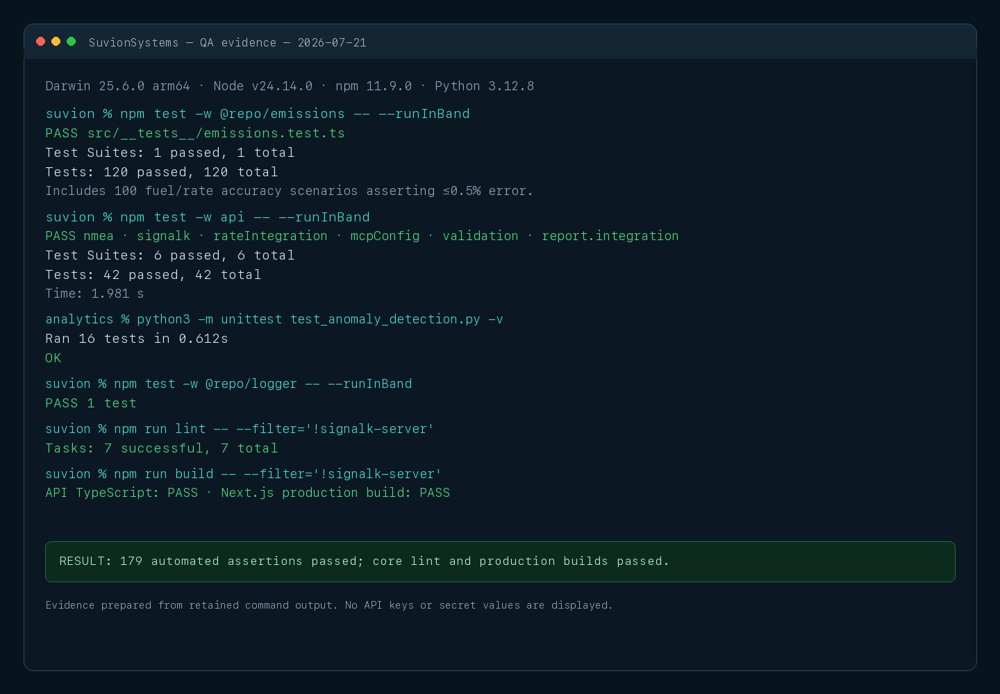
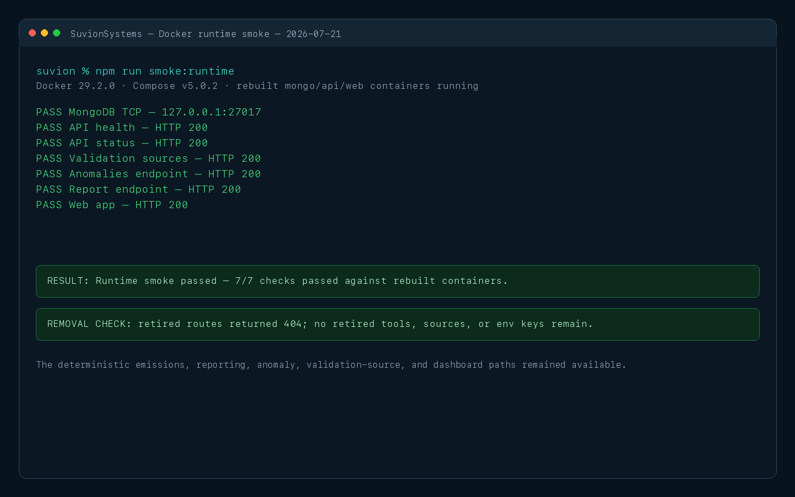
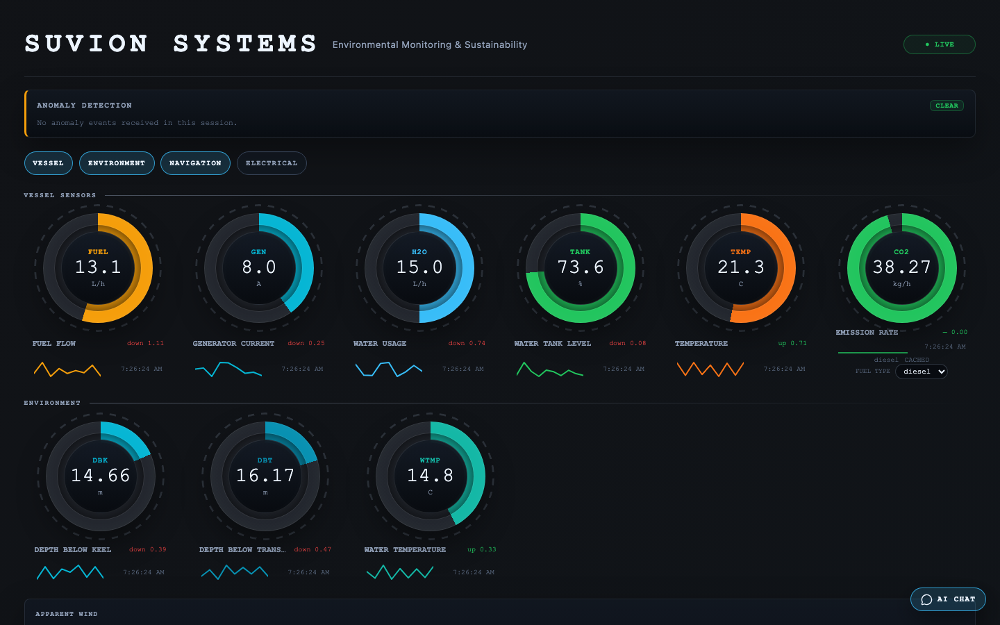
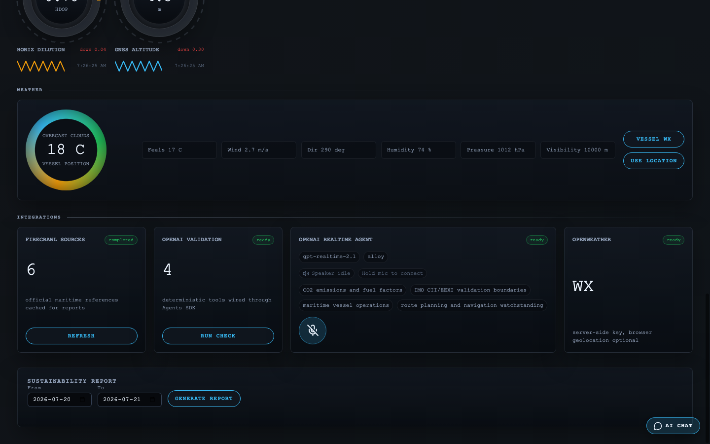
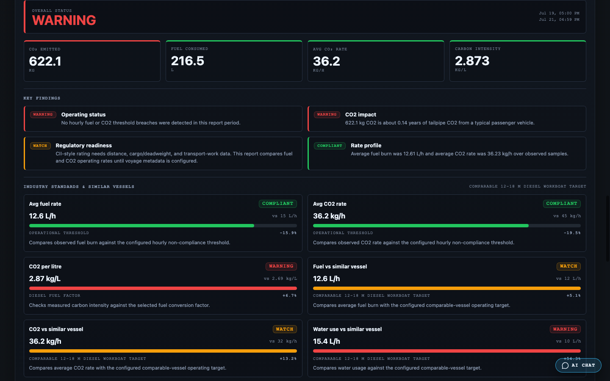

# Final Project Report

## Environmental Monitoring and Sustainability Dashboard

This final report continues the approved Suvion Systems proposal reproduced on the preceding pages. It records the delivered system, the requirements and design changes made to achieve the intended functionality and software quality, the final QA results with screenshot proof, conclusions, lessons learned, and future possible enhancements.

**Report date:** July 21, 2026  
**QA execution date:** July 21, 2026

## Executive Summary

Suvion Systems was proposed as a simulation-first environmental monitoring dashboard for small vessels. The finished prototype delivers the central project objective: it accepts simulated NMEA0183 vessel data, displays live operational information, calculates fuel-related carbon dioxide emissions, stores selected readings, and generates date-range sustainability reports in JSON, CSV, and PDF formats.

The final implementation is broader than the original minimum viable product. It adds a deterministic anomaly-detection module, operational threshold warnings, source metadata, industry comparisons, live-weather support, and optional validation and realtime voice agents. These additions were isolated from the deterministic emissions and reporting path so the core application can continue operating without external services.

The design also changed in several important ways. Direct UDP ingestion into the API became the reliable default, with Signal K retained as an optional compatibility bridge. Instantaneous rates are now integrated over elapsed time rather than incorrectly summed. Fresh-water tank level and water-use rate are treated as different measurements. Finally, the reporting language was made more conservative: threshold exceedances are useful operational warnings, but the prototype does not certify IMO compliance.

QA is strong but not entirely complete. In the prepared test environment, 179 automated assertions passed: 120 emissions tests, 42 API tests, one logger test, and 16 analytics tests. Core lint and production builds also passed. After the optional integration scope was narrowed, the rebuilt Docker stack passed all seven runtime smoke checks. Fresh browser evidence shows populated live widgets, the reduced four-card integration surface, a working category-filter interaction, and a generated sustainability report. Several proposal-level targets remain unverified, especially true generator-to-dashboard latency, packet-loss measurement, dashboard simulation start/stop timing, automated PDF-content assertions, and full browser end-to-end coverage.

The appropriate final conclusion is therefore that Suvion Systems is a functional and demonstrable prototype with a tested deterministic core, while external integration reliability, clean-environment reproducibility, UI automation, and regulatory-grade validation require further work.

## Project Outcome and Delivered Functionality

The project delivered the following functional capabilities:

- A Next.js single-page dashboard with vessel, environmental, navigation, and electrical categories.
- An always-on API UDP listener for simulated NMEA0183 packets and an optional Signal K WebSocket adapter.
- Live Socket.IO broadcasts for sensor readings, connection status, emissions, and anomaly events.
- MongoDB persistence for fuel, generator current, water-use rate, temperature, emissions, anomaly events, and lifecycle audit records.
- A TypeScript emissions engine covering diesel, MGO, MDO, HFO, and LNG.
- Time-based integration of fuel, water, and carbon dioxide rates into report totals.
- Date-range sustainability reports with JSON, CSV, and PDF responses.
- Operational threshold flags, hourly series, comparisons, explanatory insights, source metadata, and explicit non-certification wording.
- A deterministic Python Isolation Forest implementation with API and dashboard surfaces.
- Optional Firecrawl source refresh, OpenAI validation/realtime functions, and OpenWeather lookup.
- A Docker Compose deployment for MongoDB, the API, and the web application, with Signal K available through an optional profile.

The following proposal items were not completed or remain outside the demonstrated scope:

- Physical sensor or vessel-hardware validation.
- A repository-owned NMEA2000 simulator.
- Dashboard controls to start, stop, or select simulator scenarios.
- Authentication, authorization, TLS termination, or multi-user access control.
- Regulatory certification or a complete IMO CII/EEXI assessment.
- Optimization recommendations.
- Automated dashboard component and browser end-to-end tests.
- A cryptographically signed full-data wipe and a standalone privacy-scanning script.

## Requirements and Proposed-Design Changes

Implementation and QA exposed assumptions that needed to be corrected or narrowed. The changes below were made to achieve reliable functionality and improve software quality.

| Area | Proposal or initial design | Final requirement/design and quality rationale |
|---|---|---|
| Ingestion topology | Signal K was a mandatory hub in the simulated-data path. | The simulator sends directly to the API UDP listener by default. Signal K remains an optional bridge. This reduced installation and connection fragility while preserving compatibility with the open marine data ecosystem. |
| Rate aggregation | Report totals were described as MongoDB aggregation without a precise rate-to-volume rule. | Fuel, water, and CO2 readings are treated as rates and integrated over elapsed sample intervals. This prevents the serious error of adding L/h or kg/h samples as if each sample were already a volume or mass. |
| Water semantics | Water was represented as one general stream. | Water-use rate and fresh-water tank level are distinct. Tank level is displayed but is not accumulated as water consumption. This avoids a unit and meaning mismatch. |
| Threshold terminology | Some proposal sections used “non-compliant” or “standards-compliant” wording. | The implementation uses configurable operational thresholds (15 L/h fuel and 45 kg/h CO2). Reports include a disclaimer because those thresholds do not establish regulatory non-compliance or a full CII result. |
| Report contract | Twelve required fields and basic CSV/PDF export were proposed. | The report now includes a larger schema, source and calculation metadata, hourly series, comparisons, insights, and impact facts. The schema currently requires 13 top-level properties even though some documentation still says 12; this count must be reconciled. |
| Storage | Native MongoDB time-series collections were proposed. | The prototype uses ordinary schema-validated collections with timestamp and compound indexes. This is adequate at current volume but should not be described as a native time-series implementation. |
| Anomaly detection | Machine-learning anomaly detection was future work. | A seeded, dependency-light Isolation Forest, scheduler, persistence model, endpoint, Socket.IO event, and UI panel were pulled forward after the reporting core was implemented. |
| Optional integrations | The proposal emphasized open-source components and no paid services. | Firecrawl, OpenAI, and OpenWeather remain optional supporting services. A credential-dependent proprietary route-check integration was removed because it added deployment and QA failure surface without contributing to deterministic calculations. |
| Dashboard breadth | Four core environmental streams were central to the proposal. | The simulator and dashboard expanded to navigation, wind, GNSS, depth, tank level, position, speed, log, trip, and battery-related display categories. Only the four core operational streams are persisted for reports. |
| Deployment | One local deployment was assumed. | Docker Compose now packages the core stack. Signal K is optional, and server secrets must be provided to Compose through a root `.env` or an explicit `--env-file`; nested application `.env` files are not automatically used for Compose substitution. |

### Quality-Driven Corrections

The most important corrections were not cosmetic features. They changed how the system interprets data:

1. **Integrating rates over time.** A reading of 12 L/h sampled four times in one hour is not 48 L. The report now calculates quantity from rate and elapsed duration.
2. **Separating similar-looking measurements.** A tank percentage is a state measurement; L/h is a flow. Treating both as “water” would corrupt reports.
3. **Narrowing compliance claims.** The prototype has insufficient transport-work, distance, vessel-particular, and regulatory context to certify CII or other IMO compliance outcomes.
4. **Keeping external services optional.** Weather and AI-assisted validation can enrich a demonstration, but deterministic calculations and report creation remain local and auditable.

## Final System Design

### Runtime Data Flow

The demonstrated simulation path is:

**Python NMEA0183 generator → API UDP listener → parser and normalization → Socket.IO dashboard update → selected MongoDB persistence → emissions calculation → report aggregation.**

Signal K is an alternate input path rather than a required intermediary. This means a local demonstration can operate with fewer services, while a vessel installation can still use Signal K as a normalization and integration layer.

### Reporting Design

The report endpoint validates its input dates and fuel type, retrieves time-ordered readings, integrates rate samples, computes averages, groups hourly values, applies prototype operational thresholds, validates the JSON contract, and serializes JSON, CSV, or PDF. Source metadata and calculation-basis text make the result easier to audit. Reports explicitly state that the output is informational and not a regulatory certificate.

### Reliability and Failure Isolation

MongoDB, the API, and the web application form the deterministic core. Firecrawl, OpenAI, and OpenWeather are external integrations. Their status endpoints distinguish absent configuration from upstream errors so an operator can tell a setup problem from a core-system failure. The July 21 runtime test confirms that all seven defined Docker smoke checks pass after removing the unused proprietary route-check surface.

### Known Design Defects

The current emissions cache is keyed by fuel type and time-to-live, but not by the consumption-rate value. A changed fuel rate within the 60-second cache window can therefore reuse a stale carbon dioxide result. The existing cache tests check repeated values and fuel-type invalidation but do not cover this case. This should be fixed before claiming continuously accurate live emissions under changing load.

The Docker API image is Node-only and does not copy the analytics directory or install Python and its MongoDB dependency. Consequently, enabling the anomaly scheduler inside the current API container will fail even though the standalone Python analytics suite passes. The analytics workload should become a dedicated service or be packaged into the API image.

## QA Approach and Test Environment

QA used a combination of automated unit/integration tests, static quality gates, production builds, Docker runtime smoke checks, live optional-integration status checks, and rendered dashboard inspection.

**Test date:** July 21, 2026  
**Host:** Darwin 25.6.0 arm64  
**Node/npm:** Node v24.14.0; npm 11.9.0  
**Python:** 3.12.8  
**Docker:** 29.2.0; Docker Compose v5.0.2  
**Docker services:** MongoDB, API, and web containers  
**Browser evidence:** Local headless Chromium at 1440 × 900 through the browser debugging protocol. The in-app browser was attempted first but reported no available browser. No repository-owned Playwright suite exists.

API integration tests were rerun with normal local socket access because MongoDB Memory Server must bind a local test port. Secret values were never printed. The API container was checked only for the presence of `OPENAI_API_KEY` and `OPENWEATHER_API_KEY`.

## QA Test Results

### Conducted Test Summary

Every conducted test below has an explicit outcome and a screenshot reference. Figures 2–6 are copied into this report as proof of the observed results.

| QA ID | Conducted test | Result | Screenshot proof |
|---|---|---|---|
| QA-01 | Emissions unit suite: `npm test -w @repo/emissions -- --runInBand` | **PASS — 120/120** | Figure 2 |
| QA-02 | API Jest suite: `npm test -w api -- --runInBand` | **PASS — 42/42; 6 suites** | Figure 2 |
| QA-03 | Report integration subset within the API suite | **PASS — 21/21 within fixture scope** | Figures 2 and 6 |
| QA-04 | Analytics suite: `python3 -m unittest test_anomaly_detection.py -v` | **PASS — 16/16** | Figure 2 |
| QA-05 | Logger suite: `npm test -w @repo/logger -- --runInBand` | **PASS — 1/1** | Figure 2 |
| QA-06 | Filtered core lint and production build | **PASS — 7 lint tasks; API and web builds** | Figure 2 |
| QA-07 | Docker runtime smoke: `npm run smoke:runtime` | **PASS — 7/7** | Figure 3 |
| QA-08 | Removed-integration verification: retired GET/POST routes plus active-file scan | **PASS — both routes HTTP 404; no active references** | Figures 3 and 5 |
| QA-09 | Optional integration status rendering | **PASS — status cards rendered** | Figure 5 |
| QA-10 | Dashboard load and live sensor rendering | **PASS — correct page, populated widgets, `LIVE`, no error overlay** | Figure 4 |
| QA-11 | Reduced integration layout | **PASS — four expected cards; removed card absent** | Figure 5 |
| QA-12 | Dashboard report-generation interaction | **PASS — result rendered with status and four KPIs** | Figure 6 |

The browser interaction also toggled the Vessel category off and back on; the vessel section disappeared and returned as expected. Browser event capture reported no console errors or warnings. These observations are interaction evidence, not a substitute for a committed browser end-to-end suite.

### Automated Test Evidence



**Figure 2. Automated QA proof.** The screenshot records the command summaries for the emissions, API, analytics, and logger suites and the filtered lint/build gates. The fresh rerun produced 179 passing automated assertions: 120 emissions, 42 API, 16 analytics, and one logger assertion.

The 21 report-integration assertions include schema validation, threshold flags, rate integration, CSV output, one-day/week/month requests, and 50 concurrent one-day requests under five seconds. The data fixture represents 24 hours; it is not a fully populated month. The current runtime report log contains 594 entries, a 92 ms maximum recorded duration, and no entry at or above 5,000 ms. These are local-fixture results, not a production load benchmark.

### Docker Runtime and Removal Evidence



**Figure 3. Docker runtime and removal proof.** All seven smoke checks passed against rebuilt MongoDB, API, web, and simulator services. Separate GET and POST requests to the retired routes returned HTTP 404, and a case-insensitive scan found no matching active source, documentation, script, or environment wiring.

### Rendered Dashboard Evidence



**Figure 4. Live dashboard proof.** The rebuilt Docker-hosted page rendered populated fuel, generator, water, tank, temperature, emissions, depth, and water-temperature widgets with a `LIVE` Socket.IO indicator. This proves visible live rendering during the capture; it does not by itself prove packet-loss or p95 latency targets.



**Figure 5. Integration-surface proof.** The recaptured panel contains exactly the four intended cards—Firecrawl Sources, OpenAI Validation, OpenAI Realtime Agent, and OpenWeather. The removed integration is absent, and the adjacent report controls are visible.



**Figure 6. Report-generation proof.** Selecting `Generate Report` produced a rendered result with overall status, CO2 emitted, fuel consumed, average CO2 rate, carbon intensity, key findings, and industry comparisons. The screenshot proves the browser interaction and rendered result for the selected local fixture.

### Proposal Acceptance-Criteria Assessment

| Original success criterion | Final assessment | Qualification |
|---|---|---|
| Simulated data appears within one second with 100% value accuracy and no loss. | **Not verified** | NMEA parsing and normalization tests pass, but the present logging does not retain both generator emission and browser receipt timestamps or sequence IDs. |
| CO2 calculation error is below 0.5% across five fuel types and 20 rates. | **Passed within current test design** | All 100 matrix scenarios passed. However, the reference calculation imports the same production constants, so an independent versioned golden dataset is still needed. |
| Reports are generated within five seconds. | **Passed within fixture scope** | Automated ranges and concurrent requests passed; 594 current log entries had a 92 ms maximum and none reached five seconds. A realistic month-scale dataset and production-like load remain untested. |
| Required report fields are complete. | **Passed, with documentation discrepancy** | Runtime schema validation passes, but the implementation requires 13 top-level properties while documentation refers to 12. |
| Threshold periods are correctly flagged. | **Passed as operational threshold logic** | Tests verify 15 L/h and 45 kg/h exceedances. These are prototype operating thresholds, not proof of IMO non-compliance. |
| Simulation starts/stops in under two seconds and the dashboard changes scenarios. | **Not verified** | The simulator is controlled from the CLI and the dashboard has no start/stop/scenario controls. |

## Software Quality Assessment

### Correctness

The strongest correctness evidence is the emissions matrix, rate-integration regression suite, schema validation, and threshold-detection tests. The tests caught and protect against the rate-versus-volume aggregation error. Correctness is weakened by the cache-key defect and by the emissions reference calculation sharing production constants.

### Performance

All automated report requests completed well below five seconds, including 50 concurrent requests. The current reporting log contains 594 entries with a maximum duration of 92 ms and no entry at or above five seconds. These results demonstrate ample headroom for the small fixture, but they do not predict performance for 30 days of high-frequency vessel telemetry.

### Reliability and Resilience

The Docker stack served MongoDB, API, report, anomaly, validation-source, and web endpoints during testing, and all seven defined smoke checks passed. Clean/cold test reproducibility still needs work: API tests depend on a previously built emissions package, and MongoDB Memory Server can exceed Jest's default setup timeout while downloading its binary.

### Maintainability and Testability

The code is divided into focused adapters, routes, services, schemas, shared packages, and analytics modules. Lint and production builds pass. Testability is reduced by the missing Turbo dependency from `test` to upstream package builds, the broad `apps/*` workspace glob, the absence of web tests, and the lack of a first-party continuous-integration workflow or coverage thresholds.

### Security, Privacy, and Governance

API keys remain server-side, and status checks were performed without exposing their values. MongoDB schemas restrict persisted fields, and a 30-day deletion scheduler exists. Before real-vessel use, the application still needs authentication, TLS, restricted CORS, secret-management guidance, retention tests, anomaly-record deletion coverage, and explicit governance for data sent to OpenAI, Firecrawl, or OpenWeather. The existing data-wipe log is descriptive rather than cryptographically signed.

## Failures, Limitations, and Unverified Claims

The following points must remain visible in any demonstration or assessment:

- The root workspace is not fully green when the Signal K source checkout is included. Suvion-owned filtered suites pass, but repository/workspace boundaries need correction.
- A cold API test may fail while MongoDB Memory Server downloads a binary or while upstream packages have not been built.
- The browser capture verifies page identity, live rendering, a category-toggle state change, integration-card composition, and report generation. It does not replace a committed cross-browser end-to-end suite for reconnect behavior, date validation, CSV/PDF downloads, weather interactions, or voice interactions.
- No automated PDF content assertion exists even though PDF generation is implemented.
- Historical milestone statements about 100% packet delivery, 310 ms p95 latency, a 24-hour replay, or a 0.28% maximum emissions error are not supported by retained logs or screenshots in the current repository and are not treated as proven here.
- The dashboard screenshots verify populated rendering, integration composition, and report-result display only; they do not prove generator-to-browser packet timing or loss.
- The system generates operational sustainability information; it does not issue a regulatory certificate.

## Conclusions

Suvion Systems achieved its primary educational and technical goal: a small-vessel sustainability prototype can be demonstrated without physical vessel hardware by routing simulated marine data through a real ingestion, calculation, persistence, dashboard, and reporting stack.

The deterministic core is the project's strongest result. Emissions, report calculations, parser behavior, and anomaly logic have repeatable automated coverage, and the rebuilt core stack passes every defined runtime smoke check. The design changes made during implementation—direct UDP as the default, time integration of rates, stricter measurement semantics, a narrower optional-integration surface, and conservative compliance wording—materially improved correctness and deployability.

The final QA outcome is qualified rather than absolute. Automated core tests and builds pass, but the total product is not yet production-ready or regulatory-grade. External integration health, clean-environment test setup, continuous UI verification, true end-to-end telemetry metrics, and security controls are the main gaps.

## Lessons Learned

1. **Units and measurement semantics must be designed before aggregation.** Rate, quantity, and level cannot share the same summation logic merely because they are all numeric sensor readings.
2. **A simpler default path can improve both quality and demonstrability.** Direct UDP made the core demo more reliable, while an optional Signal K adapter preserved extensibility.
3. **Simulation is valuable only when evidence is retained.** A long run is not proof unless sequence identifiers, timestamps, logs, and repeatable analysis scripts are saved.
4. **Automated tests can still share assumptions.** Using production constants in the reference calculation proves internal consistency, not independent validation against an external golden dataset.
5. **Operational warnings are not regulatory findings.** Precise language and disclaimers are software-quality controls when users may rely on environmental reports.
6. **Optional services must justify their operational cost.** Removing a credential-dependent route-vendor integration simplified deployment and testing while leaving deterministic emissions and reporting functionality unchanged.
7. **Reproducibility includes orchestration.** Passing tests after manual preparation is not enough; task dependencies, binary setup, workspace boundaries, and CI must make a clean run reliable.
8. **Screenshots complement, but do not replace, assertions.** Visual proof demonstrates what was rendered, while test code and logs establish calculated behavior and failure conditions.

## Future Possible Enhancements

### Priority 1: Correctness and Reproducibility

- Include consumption rate in the emissions cache key, or remove the cache for inexpensive calculations; add a regression test for changing rates within 60 seconds.
- Add independent, version-controlled golden emissions fixtures sourced from documented IMO factors instead of importing the same constants used by production code.
- Add generator sequence IDs and emission timestamps, browser receipt instrumentation, packet-loss analysis, and automated p50/p95/p99 latency reports.
- Make Turbo tests depend on upstream builds and prevent the optional Signal K source checkout from being swept into core workspace commands.
- Increase or prepare the MongoDB Memory Server setup timeout/cache so cold test runs are deterministic.

### Priority 2: Product-Level QA

- Add React component tests and browser end-to-end tests for live widgets, category filters, reconnect reset, date validation, report display, CSV/PDF downloads, weather, and error states.
- Add automated PDF response and content checks.
- Test reports against realistic one-week and one-month datasets and record throughput, memory, and tail latency.
- Add retention, data-wipe, schema-privacy, and anomaly-lifecycle tests.
- Add a first-party CI workflow with lint, build, unit/integration, browser, and coverage gates.

### Priority 3: Deployment and Integration

- Package analytics as a dedicated Docker service, or include Python, analytics code, and dependencies in the API image.
- Pin the Signal K image version rather than relying on `latest`.
- Align documentation and Compose defaults for validation/realtime feature flags.
- Move server-side keys to the Compose project `.env` or use an explicit `--env-file`; document container recreation after environment changes.

### Priority 4: Product Scope

- Add dashboard simulation controls and verify start/stop/scenario transitions under two seconds.
- Add NMEA2000 fixtures and, later, hardware-in-the-loop testing with recorded vessel data.
- Load persisted anomaly history on dashboard start and add optional notification channels.
- Use native MongoDB time-series collections and TTL indexes if telemetry volume grows.
- Add authentication, role-based access, TLS, restricted origins, and managed secret storage before real-vessel deployment.
- Implement genuine CII/EEXI calculations only after adding distance, transport work, vessel particulars, deadweight/cargo, and applicable regulatory rules.

## Appendix A. Reproducible QA Commands

```sh
# Deterministic calculation tests
npm test -w @repo/emissions -- --runInBand

# API and report integration tests
npm test -w api

# Python anomaly tests
cd analytics
python3 -m unittest test_anomaly_detection.py -v
cd ..

# Core quality gates, excluding the optional Signal K source checkout
npm run lint -- --filter='!signalk-server'
npm run build -- --filter='!signalk-server'
npm test -- --filter='!signalk-server'

# Full local runtime smoke test after starting Docker services
npm run smoke:runtime

# Report timing-log summary
jq -s '{entries:length, max_duration_ms:(map(.durationMs)|max), reports_at_or_over_5s:(map(select(.durationMs >= 5000))|length)}' apps/api/reporting-api.log
```

## Appendix B. Evidence and Traceability

Primary implementation and test artifacts include:

- Original proposal and acceptance criteria: `docs/proposal-v2-final.pdf`
- Integration runbook: `docs/integration-testing.md`
- Optional integration behavior: `docs/integrations.md`
- Official-source policy: `docs/validation/official-sources.md`
- Emissions tests: `packages/emissions/src/__tests__/emissions.test.ts`
- API tests: `apps/api/src/__tests__/`
- Report integration tests: `apps/api/src/__tests__/report.integration.test.ts`
- Analytics tests: `analytics/test_anomaly_detection.py`
- Runtime smoke script: `scripts/runtime-smoke.mjs`
- Final QA screenshots: `docs/evidence/qa-automated-results.png`, `docs/evidence/qa-runtime-smoke.png`, `docs/evidence/dashboard-live.png`, `docs/evidence/dashboard-integrations.png`, and `docs/evidence/dashboard-report-result.png`

These artifacts support the claims made in this final report. Where the evidence is incomplete, the result is explicitly marked partial or not verified.
