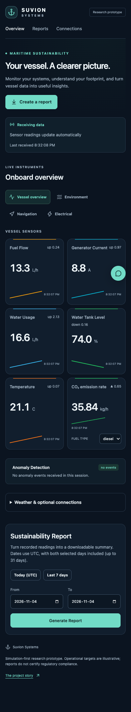

# Dashboard user guide

## Start with vessel overview

After following the [quick start](../README.md#quick-start), open
[localhost:4000](http://localhost:4000). The default Docker stack already includes
synthetic data; a native setup needs the simulator running in a separate terminal.

The overview groups fuel flow, generator current, water use, tank level, ambient
temperature, and estimated CO₂ into readable cards. Units appear beside each value.
Sparklines show the last 30 received values, not a fixed time duration. The fuel
selector changes the **shared API setting for future fuel readings**, affecting all
connected dashboards. It does not rewrite historical emissions.

| Feed indicator      | Meaning                                       | Next step                                                                  |
| ------------------- | --------------------------------------------- | -------------------------------------------------------------------------- |
| Receiving data      | API connected and sensor packets are arriving | Review values and their timestamps                                         |
| Waiting for sensors | API connected; no readings received yet       | Start the simulator or configured Signal K source                          |
| Sensor feed paused  | No readings received for 15 seconds           | Check source process and API logs                                          |
| API disconnected    | Dashboard cannot connect to the backend       | Start the API and check the configured API address; reconnect is automatic |

A dash means unavailable. A numeric zero means a received zero reading. Individual
readings expire after 15 seconds even when other streams continue to update.

## Choose a system

Use the system buttons to show vessel, environment, navigation, or electrical
instruments. The simulator includes environment and navigation signals. Electrical
signals require an appropriate Signal K connection. An empty system explains what
is missing instead of showing an apparently working zero-value instrument.

Navigation values are experimental monitoring displays. The compass labels its reference: simulator
heading is magnetic and the optional Signal K `headingTrue` path is true heading.
Verify source conventions before interpreting the instrument.

## Generate a report

1. Go to **Reports** or choose **Create a report**.
2. Select dates, or use **Today (UTC)** / **Last 7 days**. Both selected days are
   included; a range may span at most 31 days. Dates and report times use UTC.
3. Choose **Generate Report**. Review coverage before interpreting totals.
4. Download CSV or PDF. Downloads use the dates of the displayed report.

Reports integrate recorded rate samples, retaining each sample for no more than
five minutes by default. Gaps are excluded from totals. Low coverage may indicate
that the simulator was started recently, stopped, or lost data. An empty period
is **no data**, not evidence of zero fuel use. The default full-day report can
show low coverage when the demo has run for only a few minutes.

“Within demo targets” and “Target exceeded” refer to illustrative operational
thresholds. They are not regulatory findings. Reference comparisons and CO₂
context facts should be read with the linked methods and source dates. The
current implementation does not calculate a vessel's attained IMO CII rating.

## Optional features

Expand **Weather & optional connections** for additional services. No API key is
needed for live simulator readings or reports.

- **Weather:** choose **Get vessel weather** or **Use my location** explicitly.
  The chosen coordinates are sent to OpenWeather through the API. Browser
  geolocation requires a secure context such as localhost or HTTPS.
- **Source evidence:** Firecrawl can refresh the cache of official reference links.
  A verified source link does not certify a calculation or vessel.
- **AI assistant:** requires server configuration and explicit enable flags. It
  can receive vessel context and user prompts. Check important answers against
  recorded data and references.
- **Anomaly events:** the panel shows events received in the current session.
  “No events” does not mean the detector is enabled or that the vessel is healthy.

See [integrations](integrations.md) for setup and [security](../SECURITY.md) for the
privacy and deployment boundaries.

## Troubleshooting

| Symptom                        | Check                                                                                                    |
| ------------------------------ | -------------------------------------------------------------------------------------------------------- |
| No readings                    | `docker compose ps`; then `docker compose logs --tail=50 api simulator`                                  |
| Port already in use            | Stop the conflicting local process/stack or adjust port mappings and `NEXT_PUBLIC_API_HOST` consistently |
| Native API cannot find MongoDB | Use `MONGO_URI=mongodb://127.0.0.1:27017/suvion`; confirm the database is running                        |
| Blank or partial report        | Select UTC dates containing actual recorded readings and inspect coverage                                |
| CORS / connection failure      | Match the browser origin to `ALLOWED_ORIGINS`; rebuild the web app after changing its API address        |
| Weather/AI unavailable         | These are optional. Configure server keys and enable flags, then restart the API                         |
| Signal K stops updating        | Restart the API bridge; reconnect/backoff is not yet implemented                                         |

Do not delete Docker volumes to resolve an ordinary startup issue. They contain
recorded demo data. `docker compose down` preserves volumes.

Mobile dashboard preview

